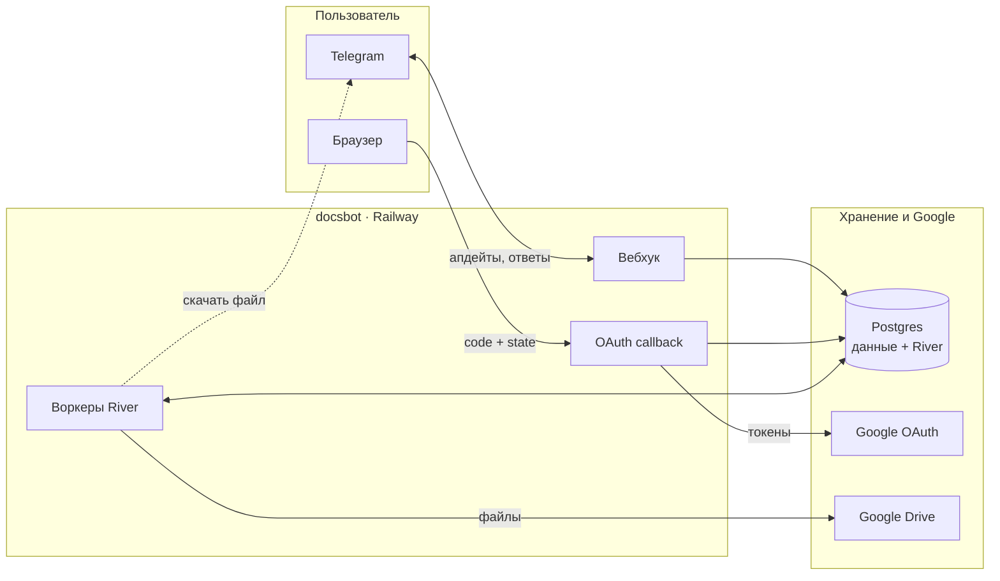
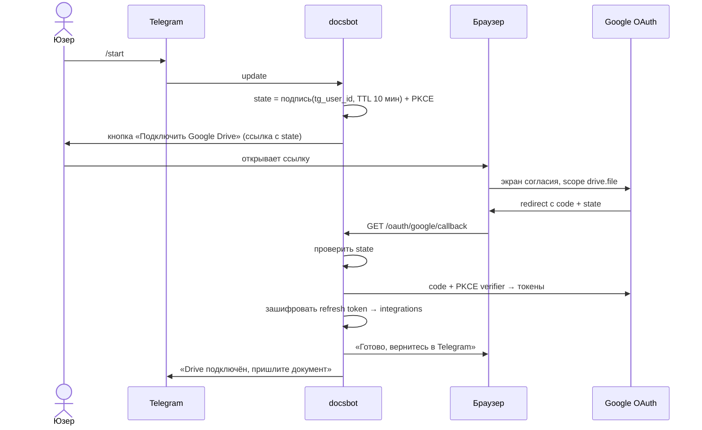
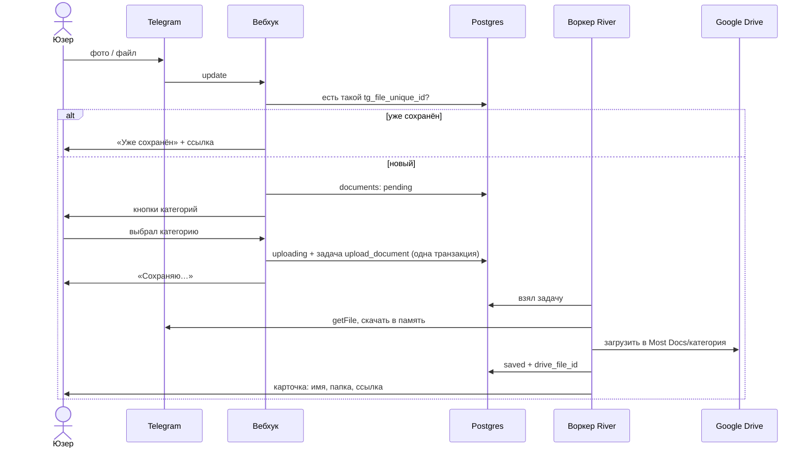

# Архитектура

Система в работе: из чего состоит, с чем общается и как ходят данные.

## MVP

### Система

Один сервис `docsbot` на Railway: в одном процессе вебхук Telegram, HTTP-эндпоинт OAuth callback и воркеры очереди River. Состояние — только в Postgres, файлы — на Drive пользователя.

### Процессы внутри docsbot

| Процесс | Что делает |
| --- | --- |
| Вебхук | Принимает апдейт, проверяет секрет, быстро отвечает 200. Лёгкие действия (кнопки, поиск, каталог) делает сам, тяжёлые ставит в River. |
| OAuth callback | Проверяет `state`, обменивает code на токены, сохраняет зашифрованный refresh token, пишет юзеру в Telegram «Drive подключён». |
| Воркеры River | `upload_document`: скачать из Telegram → загрузить на Drive → обновить статус → отправить карточку. Ретраи с backoff. |
| Периодические задачи River | `purge_users`: раз в сутки вычищает юзеров с `deleted_at`. |

Локально вместо вебхука — long polling, остальное так же.

### Подключение Google Drive

### Загрузка документа

Задача ставится в River в той же транзакции, что и смена статуса: либо оба изменения есть, либо нет ни одного.

### Надёжность

| Ситуация                                             | Что происходит                                                                                                                            |
|------------------------------------------------------|-------------------------------------------------------------------------------------------------------------------------------------------|
| Telegram повторил апдейт (вебхук не ответил вовремя) | Дубль отсекается по `unique (user_id, tg_file_unique_id)`; повторное нажатие кнопки на уже обработанном документе игнорируется по статусу |
| Drive или Telegram недоступен                        | Ретраи River с backoff; после последней попытки — `failed` и сообщение «Не удалось сохранить, попробовать ещё раз?»                       |
| Юзер отозвал доступ в Google                         | `invalid_grant` → `integrations.status = revoked` → предложение переподключить Drive                                                      |
| Рестарт или деплой сервиса                           | Задачи River в Postgres не теряются, незавершённые подхватываются после старта                                                            |
| Падение воркера на задаче                            | River вернёт задачу в очередь по таймауту                                                                                                 |

### Деплой

| Что       | Как                                                                                          |
|-----------|----------------------------------------------------------------------------------------------|
| Хостинг   | Railway: сервис `docsbot` + Postgres                                                         |
| Масштаб   | Один инстанс, вебхук и воркеры в одном процессе. Делить на два сервиса — только при нагрузке |
| Окружения | `dev` (свой бот `@most_docs_dev_bot`, своя БД) и `prod`                                      |
| Секреты   | Переменные окружения Railway: токен бота, Google client, ключ шифрования, секрет вебхука     |
| Миграции  | `goose` при старте сервиса; таблицы River — его миграциями                                   |
| Деплой    | Пуш в `main` → CI → Railway                                                                  |

## Дальше

> Заглушка. LLM vision для распознавания (v2), другие хранилища (v2), Stars (v3), напоминания (v3+), WhatsApp и Most Calendar на том же ядре.