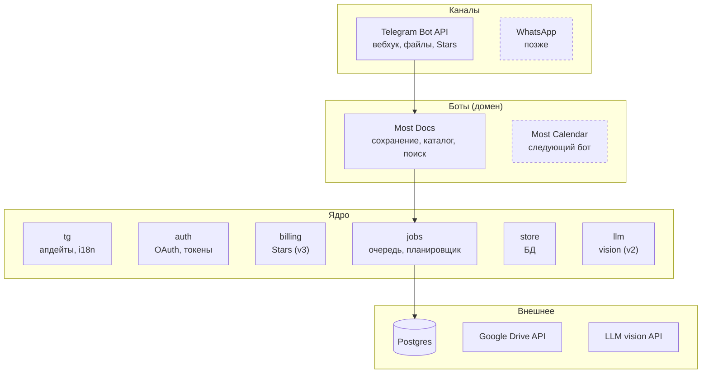
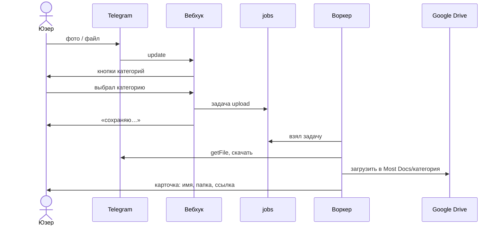

# Архитектура

> Набросок, не финал

Боты — тонкий слой над общим ядром: Telegram, OAuth, оплата, очередь и LLM живут в ядре один раз, каждый бот знает только свой домен. Каждый слой вызывает только нижний.

## Процессы внутри одного бинарника

- **Вебхук.** Принимает апдейт, сразу отвечает Telegram, тяжёлую работу кладёт в очередь.
- **Воркеры.** Берут задачи из `jobs`: скачать файл из Telegram, загрузить на Drive (с v2 — распознать); ретраи с backoff.
- **Планировщик (v1).** Раз в час берёт `reminders` с наступившим `fire_at` и шлёт напоминания в пределах лимита Telegram.

## Обработка документа

