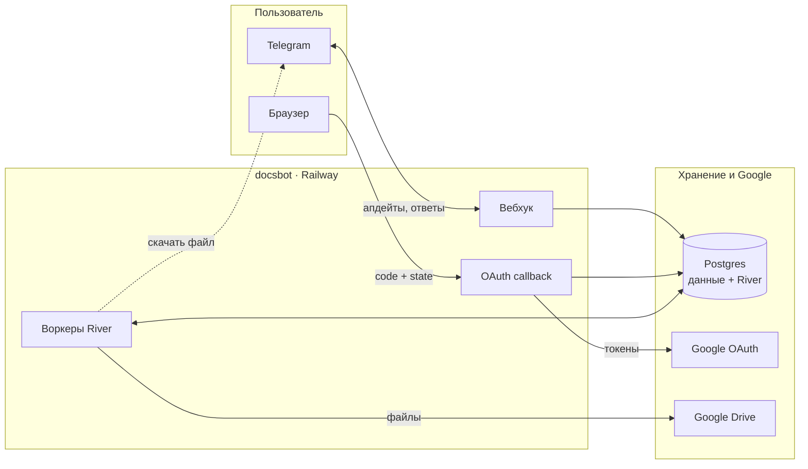
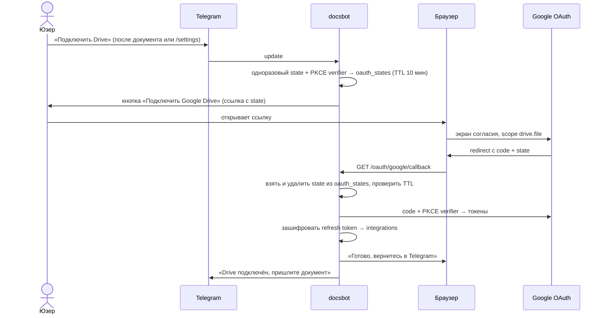
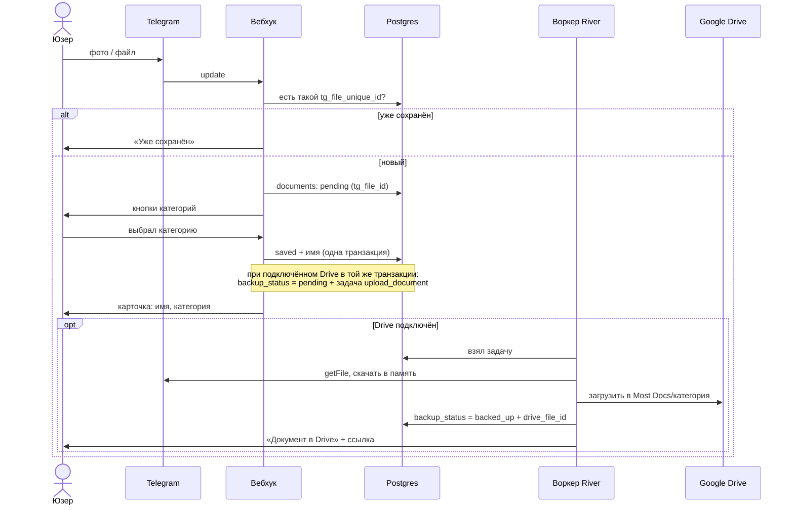

# Архитектура

Система в работе: из чего состоит, с чем общается и как ходят данные.

## MVP

### Система

Один сервис `docsbot` на Railway: в одном процессе вебхук Telegram, HTTP-эндпоинт OAuth callback, публичные страницы и воркеры очереди River. Состояние — только в Postgres. До подключения Drive файлы хранятся в Telegram (храним `file_id`, «входящая папка»); цель — перенести их на Google Drive пользователя, выгрузка идёт фоновой задачей после подключения.

### Процессы внутри docsbot

| Процесс | Что делает |
| --- | --- |
| Вебхук | Принимает апдейт, проверяет секрет, быстро отвечает 200. Лёгкие действия (кнопки, поиск, каталог, сохранение документа по `file_id`) делает сам; тяжёлое (выгрузка на Drive) ставит в River. |
| Публичные страницы | Адаптер `docsbot/web`: `/`, `/privacy`, `/terms` (RU и EN) для верификации Google OAuth. Шаблоны встроены в бинарь и рендерятся один раз при старте; контактный email — константа в адаптере. |
| OAuth callback | Проверяет `state`, обменивает code на токены, сохраняет зашифрованный refresh token, пишет юзеру в Telegram «Drive подключён». |
| Воркеры River | Очередь `docsbot/jobs`: `upload_document` — выгрузка в Drive: скачать из Telegram → загрузить на Drive → `backup_status = backed_up` + `drive_file_id`. Ставится только при подключённом Drive; при подключении — на каждый уже сохранённый документ. Файл > 20 МБ не скачать (предел Bot API), такой помечается и остаётся в Telegram. Ретраи с backoff. `storage_sync` — привести файл на Drive к строке в БД (имя, папка категории, содержимое), см. «Синхронизация». `storage_trash` — отправить файл удалённого документа в корзину Drive (строки в БД уже нет, задача хранит id файла). |
| Периодические задачи River | `sweep_uploads` (каждые 10 мин): вернуть в очередь застрявшие загрузки и синхронизации, слишком долго зависшие перевести в `failed`. `purge_pending` (раз в час): удалить документы, которым за сутки не выбрали категорию, и статус-сообщения, закрытые больше суток назад (документы остаются). `purge_users` (раз в сутки): вычистить юзеров с `deleted_at` и продуктовые события старше 180 дней. `purge_oauth_states` (раз в сутки): вычистить протухшие `oauth_states`. |

Локально вместо вебхука — long polling, остальное так же.

### Подключение Google Drive

После подключения бот спрашивает «Загрузить на Google Диск N документов из Telegram? [Да, загрузить] [Не сейчас]» и ставит их выгрузку в River. Новые документы после этого выгружаются автоматически.

### Загрузка документа

Документ сохраняется сразу после выбора категории (в Telegram по `file_id`), без очереди. Выгрузка на Drive — отдельный путь: только при подключённом Drive, задача ставится в River в той же транзакции, что и сохранение документа и `backup_status`: при сбое документ остаётся `pending`, и повторное нажатие категории делает всё заново.

### Транзакции и очередь

Изменение строки и задача к нему — одна транзакция в `docsbot/postgres`: `inTx` (`tx.go`) — единственное место, где открывается транзакция. Постановку задач `postgres` объявляет интерфейсом `JobInserter` (upload, sync, trash в переданной `tx`), реализует его `docsbot/jobs.Queue` поверх River (`postgres` не импортирует `jobs`; совпадение проверяет компилятор при сборке в `cmd/docsbot`). Порты `Uploads` и `Syncs` реализует `postgres.Documents`; отмена очередных задач пользователя (`JobCanceler`) — прямо в `jobs.Queue`, без строк БД. Очередь собирается в два шага, чтобы не было цикла «воркеры → сервис → репозиторий → очередь»: сначала `platform/jobs.NewInserter` — клиент River только для постановки и отмены задач (без очередей и воркеров), на нём строится `jobs.Queue`; затем, когда готовы сервис и `telegram.Notifier`, `docjobs.Register*` регистрирует воркеры сразу с зависимостями, а `jobs.New` создаёт рабочий клиент (`Start`/`Stop`) с теми же `MaxAttempts`. Поздней привязки зависимостей нет. Нужно ли облако, решает вызывающий флагом `cloud`: без него меняется только строка. Адаптеры `postgres` разрезаны по портам: `Documents`, `StatusMessages`, `Users`, `OAuthStore`, `FolderCache`.

Одинаковый файл, пришедший дважды одновременно, не ошибка: вставка с `on conflict do nothing` возвращает `ErrDuplicateFile`, `Receive` перечитывает победившую строку и отвечает `AlreadySaved` или `NeedCategory`.

### Статус-сообщения

Документы, пришедшие подряд (окно 30 секунд) или переносимые массово, показываются одним сообщением, которое бот редактирует по мере выгрузки (`status_messages`, `kind`: `single` — карточка одного документа, `batch` — прогресс и блоки по категориям, `transfer` — массовый перенос или повтор). Telegram-альбом (`media_group_id`) обрабатывается как одна группа. Воркер выгрузки обновляет это сообщение через `telegram.Notifier`.

### Отправка сообщений

Обработчики, конвертер и `telegram.Notifier` пишут сообщения (текст, правка, удаление, ответ на нажатие кнопки) только через `tg.Sender` (`platform/tg/sender.go`, общий для всех ботов): `Send`, `Edit`, `SetKeyboard`, `ClearKeyboard`, `Delete`, `Answer` логируют сбой сами, а `TrySend`, `TryEdit`, `TryDelete` отдают ошибку вызывающему. Файлы (`SendDocument`, `SendPhoto`, `SendMediaGroup`) уходят напрямую, не через `Sender`. Он трассирует вызов (Debug, только метод и время), логирует сбой один раз и сводит ошибки Telegram к трём случаям: «сообщение не изменилось» (для `Edit` это успех), «сообщения уже нет или его нельзя править» (`tg.IsMessageGone`) и 403 — пользователь заблокировал бота (лог Info, не Error). Там же лежит `tg.TTLMap` — карта в памяти с TTL и потолком размера для хранилищ адаптеров, и `tg.NewToken` для данных кнопок. `platform/tg` отвечает ещё за запуск, middleware и скачивание файлов и отдаёт клиент через `Client()`.

### Синхронизация с Drive

Источник правды — бот: переименование и смена категории меняют строку (`meta_version` растёт) и ставят `storage_sync`, воркер приводит файл на Drive в соответствие (переименовать, переложить в папку категории, обновить содержимое при `content_dirty`). Задача хранит только id, поэтому много правок сливаются в один прогон. Состояние — `documents.sync_status`: `ok`, `pending`, `failed`, `missing` (файл удалён на Drive вне бота). Удаление документа ставит `storage_trash`.

### Конвертер `/convert`

Команда `/convert` и кнопка «Преобразовать» на карточке: фото → PDF (в том числе альбом), сжатие изображения под лимит (1/2/5 МБ или свой в КБ, JPEG/PNG), WEBP → JPG, действия с PDF (повернуть, оставить или убрать страницы, склеить). Диалог ведёт отдельный пакет `docsbot/telegram/converter`; сама обработка — `platform/convert`: чистая библиотека «байты на входе, байты на выходе». Пакет `converter` не импортирует `telegram`: то, что ему нужно от docs-адаптера (карточка сохранённого документа, выбор категории, уведомления о лимитах), он объявляет интерфейсом `SavedView`, а источник файлов — интерфейсом `FileDownloader` (его реализует `tg.Bot`). Обратная сторона: docs-адаптер знает только публичные функции `converter.Convertible`, `converter.IsPDF`, `converter.SupportedImageMIME`, `converter.MenuCB`, `converter.AlbumCB` и интерфейс `albumPDFs` (`RegisterAlbum`), которому конвертер удовлетворяет. `telegram.Register` создаёт конвертер и подключает его обработчики (`/convert`, `/cancel`, кнопки `conv:`, сообщения пользователя с открытым диалогом) до обработчиков файлов и поиска. Состояние диалога в памяти: TTL 15 минут, не больше 10 000 открытых диалогов (сверх этого `/convert` отвечает, что слишком много сессий); хранит только `file_id` и размеры, не байты — файлы скачиваются, когда операция запускается. После рестарта диалог начинается заново. Результат можно сохранить как документ, как новый или заменить оригинал.

### Inline-режим

`@бот запрос` в любом чате ищет по собственным документам пользователя и отдаёт найденные по `tg_file_id` (фото как фото, остальное как документ). Включается и выключается в `/settings` (`docs_settings.inline_enabled`, по умолчанию включён). Незнакомый отправитель, пользователь без документов или с выключенным режимом получают пустой ответ с кнопкой перехода в бота.

### Надёжность

| Ситуация                                             | Что происходит                                                                                                                            |
|------------------------------------------------------|-------------------------------------------------------------------------------------------------------------------------------------------|
| Telegram повторил апдейт (вебхук не ответил вовремя) | Дубль отсекается по `unique (user_id, tg_file_unique_id)`; повторное нажатие кнопки на уже обработанном документе игнорируется по статусу |
| Drive не подключён                                   | Документ хранится в Telegram по `file_id`, в каталоге помечен 📥; выгрузка — после подключения Drive                                      |
| Токен бота утёк                                       | Утёкший токен даёт доступ ко всем файлам всех юзеров через Bot API. Решение: Revoke в BotFather → новый токен; старые `file_id` продолжают работать у бота |
| Бот удалён или потерян аккаунт владельца бота          | `file_id` перестают работать → доступ к файлам в Telegram теряется. Поэтому Drive — надёжная копия на стороне пользователя                 |
| Файл > 20 МБ                                          | Хранится в Telegram по `file_id`; скачать для выгрузки в Drive нельзя (предел облачного Bot API) — помечается «слишком большой для Drive» |
| Drive недоступен при выгрузке                          | Ретраи River с backoff; после последней попытки — `backup_status = failed` и предложение повторить. Документ остаётся доступен в Telegram |
| Юзер отозвал доступ в Google                         | `invalid_grant` → `integrations.status = revoked` → предложение переподключить Drive                                                      |
| Рестарт или деплой сервиса                           | Задачи River в Postgres не теряются, незавершённые подхватываются после старта; зависшие загрузки и синхронизации возвращает `sweep_uploads`  |
| Падение воркера на задаче                            | River вернёт задачу в очередь по таймауту                                                                                                 |

### Деплой

| Что       | Как                                                                                          |
|-----------|----------------------------------------------------------------------------------------------|
| Хостинг   | Railway: сервис `docsbot` + Postgres                                                         |
| Масштаб   | Один инстанс, вебхук и воркеры в одном процессе. Делить на два сервиса — только при нагрузке |
| Окружения | `dev` (свой бот `@most_files_dev_bot`, своя БД) и `prod`                                      |
| Секреты   | Переменные окружения Railway: токен бота, Google client, ключ шифрования, секрет вебхука     |
| Миграции  | `goose` при старте сервиса; таблицы River — его миграциями                                   |
| Деплой    | Пуш в `main` → CI → Railway                                                                  |

## Дальше

> Заглушка. LLM vision для распознавания (v2), другие хранилища (v2), Stars (v3), напоминания (v3+), WhatsApp и Most Calendar на том же ядре.