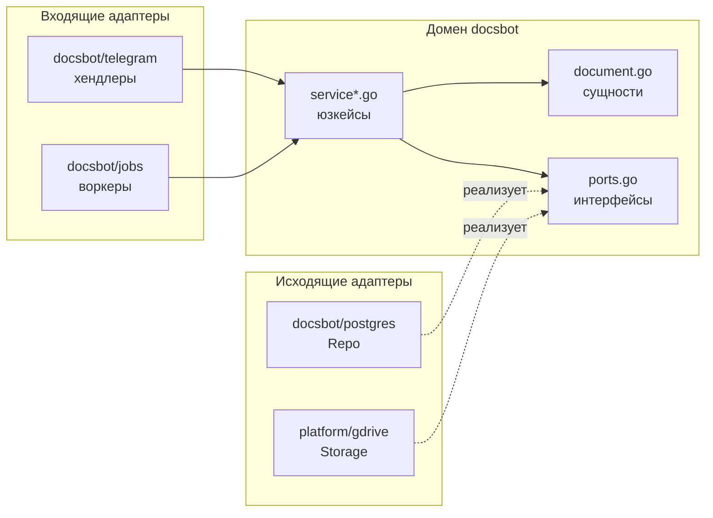
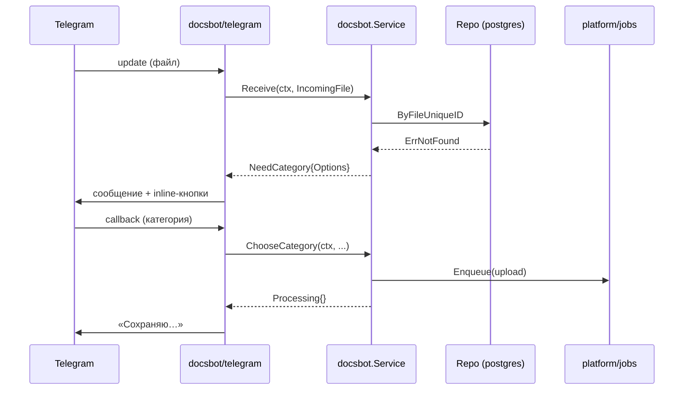
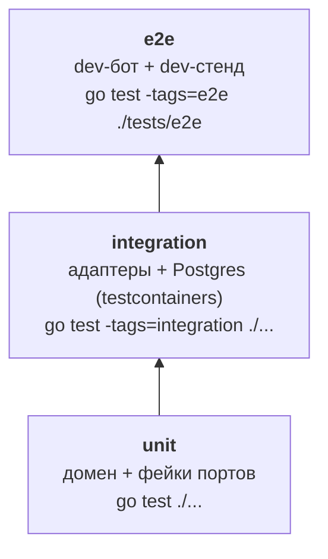

# Code conventions — Most

Как устроен и как пишется Go-код серии ботов Most. Коротко: **домен в центре, всё внешнее — адаптеры, общее — в `platform`**.

## 1. Архитектура

Облегчённый гексагон (ports & adapters). Домен знает только себя и свои интерфейсы. Telegram, Postgres, Google Drive — адаптеры, которые эти интерфейсы реализуют.



**Правила зависимостей**

| Пакет                     | Может импортировать                             | Не может                                                                                       |
|---------------------------|-------------------------------------------------|------------------------------------------------------------------------------------------------|
| `internal/docsbot` (домен)   | stdlib и пакеты без I/O | `docsbot/telegram`, `docsbot/postgres`, `platform/tg`, `platform/db`, `platform/gdrive`, внешние SDK |
| `internal/docsbot/<adapter>` | домен `docsbot`, `platform/*`, SDK              | другой бот (`internal/calendar`)                                                               |
| `internal/platform/*`     | stdlib, SDK, другие `platform/*`                | любой бот                                                                                      |
| `cmd/<bot>`               | всё                                             | —                                                                                              |

Проверяется `depguard` в `golangci-lint`.

## 2. Структура

```text
cmd/
  docsbot/main.go          # сборка зависимостей и запуск
internal/
  docsbot/                 # домен Most Files
    document.go            # сущности и value objects
    service*.go            # юзкейсы (методы Service) по темам
    ports.go               # интерфейсы, нужные домену
    errors.go              # доменные ошибки
    reply.go               # ответы юзкейсов (смысл, не UI)
    service_test.go        # unit-тесты с фейками
    fakes_test.go          # фейки портов
    telegram/              # входящий адаптер: апдейт → service → рендер; texts.go — тексты
    jobs/                  # входящий адаптер: воркеры River (upload, sync, trash, sweep, purge_pending)
    web/                   # входящий адаптер: публичные страницы /, /privacy, /terms
    postgres/              # исходящий адаптер: Repo через sqlc
  platform/                # общее ядро для всех ботов
    config/  logging/  db/  jobs/  tg/  oauth/  gdrive/  convert/
migrations/                # goose, *.sql
tests/e2e/                 # e2e против dev-стенда
docs/                      # дизайн-доки
```

- Новый бот = `cmd/<bot>/` + `internal/<bot>/` той же формы.
- Новое хранилище = новый пакет в `platform/` + 3 строки в `main.go`. Домен не меняется.
- Новый канал = новый входящий адаптер `internal/docsbot/<channel>/`.

## 3. Домен

**Сущности** — обычные struct'ы с конструктором, который валидирует (как Pydantic-модель).

```go
type Document struct {
    ID       DocumentID
    UserID   UserID
    Title    string
    Category Category
    DriveID  string
}

func NewDocument(user UserID, title string, cat Category) (Document, error) {
    if !cat.Valid() {
        return Document{}, ErrUnknownCategory
    }
    ...
}
```

**Порты** объявляет домен — ровно те методы, что ему нужны.

```go
// ports.go
type Storage interface {
    Upload(ctx context.Context, f File, folder string) (StoredFile, error)
}

type Repo interface {
    Save(ctx context.Context, d Document) error
    ByFileUniqueID(ctx context.Context, u UserID, id string) (Document, error)
}
```

**Юзкейсы** — методы одного `Service`. Возвращают смысл ответа, а не кнопки Telegram.

```go
type Service struct {
    repo    Repo
    storage Storage
}

func (s *Service) Receive(ctx context.Context, in IncomingFile) (Reply, error)
```

```go
// reply.go — адаптер канала сам решает, как это нарисовать
type NeedCategory struct{ Options []Category }
type Saved struct{ Doc Document; URL string }
type AlreadySaved struct{ Doc Document }
```

## 4. Поток запроса



## 5. Сборка зависимостей

Без DI-фреймворков. Всё собирается руками в `main.go` через конструкторы `New…` — аналог `Depends` + lifespan в FastAPI.

```go
func run() error { // main вызывает run и печатает ошибку
    ctx, stop := signal.NotifyContext(context.Background(), os.Interrupt, syscall.SIGTERM)
    defer stop()

    cfg, err := config.Load()
    if err != nil {
        return err
    }
    log := logging.New(cfg.LogLevel)
    pool, err := db.Connect(ctx, cfg.DatabaseURL)
    if err != nil {
        return err
    }
    defer pool.Close()

    repo := postgres.NewRepo(pool)
    // дальше: oauth.New, gdrive.New, docsbot.NewService(repo, ...),
    // telegram.Register(...), воркеры River, HTTP-сервер — см. cmd/docsbot/main.go
}
```

## 6. Именование

| Что | Как | Пример |
| --- | --- | --- |
| Пакеты | коротко, единственное число, без `_` | `docsbot`, `gdrive`, `oauth` |
| Не называем | `utils`, `common`, `helpers`, `models`, `base` | — |
| Файлы | `snake_case.go`, по сущности или теме | `document.go`, `upload_job.go` |
| Конструкторы | `New` / `NewXxx` | `docsbot.NewService`, `gdrive.New` |
| Интерфейсы | по роли, без префикса `I` | `Storage`, `Repo`, `Clock` |
| Ошибки | `ErrXxx` для sentinel, `XxxError` для типов | `ErrNotFound` |
| Без повторов | имя пакета — часть имени | `docsbot.Service`, не `docsbot.DocsService` |
| Сокращения | заглавными целиком | `UserID`, `HTTPClient`, `URL` |
| Получатель метода | 1–2 буквы, одинаково везде | `func (s *Service)` |

## 7. Комментарии

- Сначала — самодокументируемый код: понятное имя лучше комментария. Комментарий объясняет **почему**, а не **что** делает код.
- Комментарии — на английском. Тексты для юзера — русский, в `texts.go`.
- Doc-комментарий обязателен на экспортируемых именах, начинается с имени, одно-два предложения (проверяет `revive`):

```go
// Compress re-encodes img to fit maxBytes in the given format.
func Compress(img []byte, maxBytes int, format Format) ([]byte, error)
```

- Коротко и просто. Если комментарий длиннее кода — упрости одно из двух.
- Не дублируй сигнатуру и очевидное (`// increment i` не нужен).
- Поясняй неочевидное: инварианты, обход багов библиотек, причину решения. Номера тикетов и историю правок в код не пишем — они в коммите и PR.
- `TODO:` / `FIXME:` — с номером задачи: `// TODO(#36): ...`.
- Не оставляй закомментированный код — он есть в git.

## 8. Ошибки

- Возвращаем `error`, не паникуем. `panic` — только для ошибок программиста.
- Оборачиваем с контекстом: `fmt.Errorf("upload to drive: %w", err)`.
- Проверяем через `errors.Is` / `errors.As`.
- Доменные ошибки — в `errors.go` домена. Адаптеры переводят свои ошибки в доменные (`pgx.ErrNoRows` → `docsbot.ErrNotFound`).
- Что показать юзеру, решает адаптер канала по доменной ошибке. Текст ошибок Go юзеру не показываем.
- Логируем ошибку **один раз** — на верхнем уровне (хендлер, воркер), не на каждом слое.

## 9. context и таймауты

- `ctx context.Context` — первый аргумент любой функции с I/O.
- Не храним `ctx` в struct'ах.
- Таймауты ставят адаптеры на внешние вызовы: `ctx, cancel := context.WithTimeout(ctx, 10*time.Second)`.
- Остановка: `signal.NotifyContext` в `main`, воркеры выходят по `ctx.Done()`.
- Горутина без способа её остановить — баг.

## 10. Конфиг и логи

- Конфиг только из env в `platform/config` → типизированный struct (аналог Pydantic Settings). Пакеты получают нужные поля через конструктор, не читают env сами.
- Логи: `log/slog`, JSON, ключ-значение: `log.Info("doc saved", "user_id", u, "doc_id", d)`.
- Никогда не логируем токены, содержимое документов, подписи к файлам.

## 11. БД

- Запросы — в `.sql` файлах, код генерирует `sqlc`. Сгенерированный код живёт только в адаптере `postgres/`.
- Миграции — `goose`, файлы `migrations/NNNN_name.sql`, только вперёд в проде.
- Юзкейсу нужно несколько записей атомарно (БД и очередь) → один метод порта (`Uploads`, `Syncs` в `ports.go`); транзакция открывается внутри адаптера `postgres/`, SQL наружу не течёт.

## 12. Тесты



| pytest                             | Go                                                                                                  |
|------------------------------------|-----------------------------------------------------------------------------------------------------|
| `tests/test_*.py` отдельной папкой | `*_test.go` в той же папке, что и код (`service.go` → `service_test.go`)                            |
| —                                  | `package docsbot` — тест видит приватное; `package docsbot_test` — только публичный API (предпочтительно) |
| `@pytest.mark.parametrize`         | table-driven тесты + `t.Run`                                                                        |
| фикстуры                           | хелперы с `t.Helper()` и `t.Cleanup()`                                                              |
| маркеры                            | build tags `//go:build integration`                                                                 |
| `unittest.mock`                    | ручные фейки в `fakes_test.go`                                                                      |
| `assert`                           | `testify/require`                                                                                   |

```go
func TestService_Receive(t *testing.T) {
	tests := []struct {
		name string
		repo *fakeRepo
		want docsbot.Reply
	}{
		{"новый файл", newFakeRepo(), docsbot.NeedCategory{Options: docsbot.AllCategories}},
		{"дубль", repoWith(existingDoc), docsbot.AlreadySaved{Doc: existingDoc}},
	}
	for _, tt := range tests {
		t.Run(tt.name, func(t *testing.T) {
			svc := docsbot.NewService(tt.repo, &fakeStorage{})
			got, err := svc.Receive(context.Background(), incoming)
			require.NoError(t, err)
			require.Equal(t, tt.want, got)
		})
	}
}
```

**Уровни и команды**

- **unit** — `make test` (`go test ./...`), без Docker и сети. Домен с ручными фейками (`fakes_test.go`), `platform/*` с лёгкими зависимостями. Образец table-driven теста — `internal/platform/config/config_test.go`.
- **integration** — `make test-int` (`go test -tags=integration -count=1 ./...`), файлы с `//go:build integration`. Реальный Postgres поднимает `internal/platform/db/dbtest`: `dbtest.New(t)` стартует контейнер (модуль `postgres` из `testcontainers-go`), отдаёт `*pgxpool.Pool` и сам всё убирает через `t.Cleanup`. Образец — `internal/platform/db/dbtest/dbtest_integration_test.go`.
- **e2e** — `make test-e2e` (`go test -tags=e2e -count=1 ./tests/e2e/...`), файлы с `//go:build e2e`. Гоняет приложение целиком против dev-стенда.

`testify/require` — единственная библиотека ассертов. Фикстуры — функции-хелперы с `t.Helper()` (и `t.Cleanup()` для ресурсов: контейнеры, временные файлы). Если в директории **все** `.go`-файлы под build-тегом, добавь нетеггированный `doc.go` с объявлением пакета — иначе `go test ./...` упадёт с «build constraints exclude all Go files».

## 13. Чего не делаем

- Интерфейс «на всякий случай». Вводим, когда есть второй адаптер или нужен фейк для теста.
- Глобальные переменные и `init()` с логикой.
- Пакеты `utils` / `common`.
- Генерики там, где хватает конкретного типа.
- ORM. Только `sqlc`.
- Зависимость домена от SDK (`telegram`, `drive`, `pgx`).

## 14. Python → Go

| Python              | Go                                |
|---------------------|-----------------------------------|
| FastAPI router      | входящий адаптер `docsbot/telegram`  |
| `Depends`, lifespan | ручная сборка в `main.go`         |
| Pydantic-модель     | struct + конструктор с валидацией |
| Pydantic Settings   | `platform/config`                 |
| `async`/`await`     | горутины + `context.Context`      |
| исключения          | `error` как значение + `%w`       |
| SQLAlchemy          | `sqlc` + `pgx`                    |
| Alembic             | `goose`                           |
| `ruff` / `mypy`     | `golangci-lint` / компилятор      |