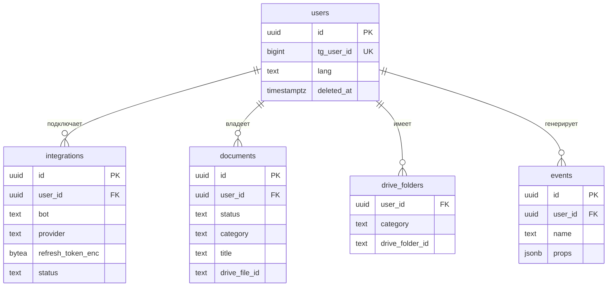

# Модель данных

В Postgres храним только метаданные; сами файлы лежат на Google Drive пользователя.

**Общие решения**
- ID — UUID v7 (сортируется по времени, не раскрывает число записей).
- Время — `timestamptz`, в UTC.
- Владелец таблицы: `platform` — общая для всех ботов серии, `docs` — только Most Docs.
- Не храним номера документов, ИИН, содержимое файлов и токены в открытом виде (см. [security.md](security.md)).
- Очередь фоновых задач — библиотека [River](https://riverqueue.com): свои таблицы и миграции она создаёт сама, в модели их не описываем.

## MVP

### Сводка

| Таблица         | Зачем                                                                                                                                                                                        | Ограничения и индексы                                                                                                                                              |
|-----------------|----------------------------------------------------------------------------------------------------------------------------------------------------------------------------------------------|--------------------------------------------------------------------------------------------------------------------------------------------------------------------|
| `users`         | Пользователь Most. Создаётся при первом `/start` в любом боте серии. Один Telegram-аккаунт = один пользователь. Мягкое удаление через `deleted_at`.                                          | `unique (tg_user_id)`                                                                                                                                              |
| `integrations`  | Подключение внешнего аккаунта для конкретного бота. У Most Docs и будущего Most Calendar свои токены и свои разрешения (scope).                                                              | `unique (user_id, bot, provider)`                                                                                                                                  |
| `documents`     | Документ, который пользователь прислал боту. Запись создаётся сразу при получении файла и проходит статусы (таблица ниже). Удаляется сразу, без мягкого удаления.                            | `unique (user_id, tg_file_unique_id)` — один файл сохраняется один раз `index (user_id, category)` — каталог `gin (title gin_trgm_ops)` — поиск с опечатками |
| `drive_folders` | Кеш папок `Most Docs/<категория>` на Drive пользователя, чтобы не искать папку через Drive API при каждой загрузке. Если папку удалили на Drive — запись удаляется и папка создаётся заново. | `primary key (user_id, category)`                                                                                                                                  |
| `events`        | Продуктовые события для метрик: активация, удержание, kill criterion.                                                                                                                        | `index (bot, name, created_at)`                                                                                                                                    |

### Статусы documents

| Статус      | Когда                                        | Следующий              |
|-------------|----------------------------------------------|------------------------|
| `pending`   | Файл получен, ждём выбора категории          | `uploading`            |
| `uploading` | Категория выбрана, задача загрузки в очереди | `saved` / `failed`     |
| `saved`     | Файл загружен на Drive                       | —                      |
| `failed`    | Загрузка не удалась после всех ретраев       | `uploading` (повтор)   |

## v1

> Заглушка. Сроки документов и напоминания: поле `documents.expires_at`, таблица `reminders`.

## v2+

> Заглушка. Распознавание (`type`, `issued_at`, `confidence`), учёт использования (`usage`), другие хранилища.

## v3+

> Заглушка. Подписки за Stars (`subscriptions`).

## Открытые вопросы
- `users` общая на серию, а `integrations` на каждого бота — подтвердить, что объединение аккаунтов не понадобится.