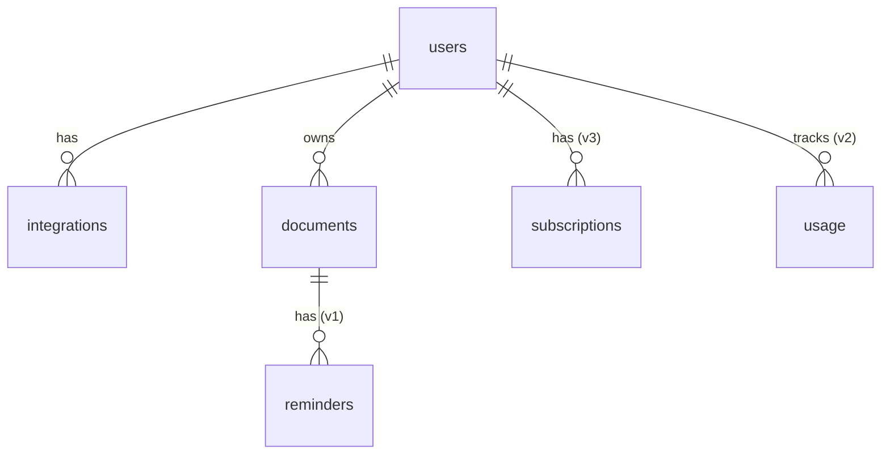

# Модель данных

> Набросок, не финал

В Postgres храним только метаданные; файлы лежат у пользователя на Drive. Таблицы ядра общие для всех ботов серии.

| Таблица         | Слой      | Ключевые поля                                                                            | Версия   |
|-----------------|-----------|------------------------------------------------------------------------------------------|----------|
| `users`         | Ядро      | `id`, `tg_user_id`, `lang`, `tz`, `created_at`, `deleted_at`                             | MVP      |
| `integrations`  | Ядро      | `user_id`, `provider` (google), `scopes`, `refresh_token_enc`, `status`                  | MVP      |
| `jobs`          | Ядро      | `type`, `payload`, `status`, `attempts`, `run_at`                                        | MVP      |
| `documents`     | Most Docs | `id`, `user_id`, `drive_file_id`, `category`, `title`, `tg_file_unique_id`, `created_at` | MVP      |
| `documents` +   | Most Docs | `expires_at`                                                                             | v1       |
| `documents` +   | Most Docs | `type`, `issued_at`, `confidence`                                                        | v2       |
| `reminders`     | Most Docs | `document_id`, `fire_at`, `kind` (30d/7d), `sent_at`                                     | v1       |
| `usage`         | Ядро      | `user_id`, `bot`, `period`, `docs_count`, `llm_tokens`                                   | v2       |
| `subscriptions` | Ядро      | `user_id`, `bot`, `plan`, `stars_charge_id`, `expires_at`                                | v3       |

- Поиск в MVP: по `title` и `category` (`ILIKE` или `pg_trgm`).
- `tg_file_unique_id` — защита от повторной загрузки одного файла.
- В БД не пишем номера документов и ИИН (см. [security.md](security.md)).
