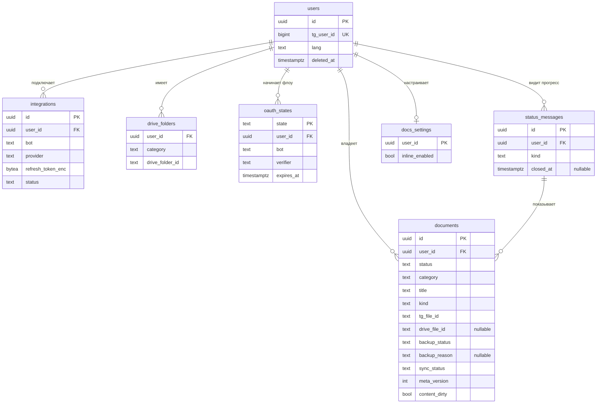

# Модель данных

В Postgres храним только метаданные (включая Telegram `file_id`). Сами файлы остаются в Telegram; при подключённом Drive копия лежит на Диске пользователя.

**Общие решения**
- ID — UUID v7 (сортируется по времени, не раскрывает число записей).
- Время — `timestamptz`, в UTC.
- Владелец таблицы: `platform` — общая для всех ботов серии, `docs` — только Most Files (бот `docsbot`).
- Не храним номера документов, ИИН, содержимое файлов и токены в открытом виде (см. [security.md](security.md)).
- Очередь фоновых задач — библиотека [River](https://riverqueue.com): свои таблицы и миграции она создаёт сама, в модели их не описываем.

## MVP

### Сводка

| Таблица         | Зачем                                                                                                                                                                                        | Ограничения и индексы                                                                                                                                              |
|-----------------|----------------------------------------------------------------------------------------------------------------------------------------------------------------------------------------------|--------------------------------------------------------------------------------------------------------------------------------------------------------------------|
| `users`         | Пользователь Most. Создаётся при первом `/start` в любом боте серии. Один Telegram-аккаунт = один пользователь. Мягкое удаление через `deleted_at`.                                          | `unique (tg_user_id)`                                                                                                                                              |
| `integrations`  | Подключение внешнего аккаунта для конкретного бота. У Most Files и будущего Most Calendar свои токены и свои разрешения (scope).                                                              | `unique (user_id, bot, provider)`                                                                                                                                  |
| `oauth_states`  | Одноразовый `state` + PKCE verifier OAuth-флоу, привязан к `user_id` и боту. Создаётся при выдаче auth-ссылки, удаляется в callback. TTL 10 минут через `expires_at`.                        | `primary key (state)` `index (expires_at)` — чистка протухших                                                                                                   |
| `documents`     | Документ, присланный боту. Создаётся при получении, сохраняется сразу после выбора категории (в Telegram по `tg_file_id`). Drive-поля (`drive_file_id`, `backup_status`) заполняются только при выгрузке на Drive. Удаляется сразу, без мягкого удаления. `category` — slug из `docsbot/category.go` (без CHECK); неизвестный slug читается как `other`.                            | `unique (user_id, tg_file_unique_id)` — один файл сохраняется один раз `index (user_id, category)` — каталог `gin (title gin_trgm_ops)` — поиск с опечатками |
| `status_messages` | Сообщение с прогрессом выгрузки, которое бот редактирует на месте. Документы привязаны через `documents.status_message_id`. `kind`: `single`, `batch`, `transfer`; `closed_at` — когда сообщение закрыто. Владелец: `docs`. | `index (user_id) where closed_at is null` — открытое сообщение пользователя |
| `docs_settings` | Настройки пользователя в Most Files (сейчас `inline_enabled`, по умолчанию включено). Отдельная таблица, а не колонки `users`: `users` общая для всех ботов. Нет строки — значения по умолчанию. Владелец: `docs`. | `primary key (user_id)` |
| `drive_folders` | Кеш папок `Most Docs/<категория>` (имя корневой папки — `DRIVE_ROOT_FOLDER`) на Drive пользователя, чтобы не искать папку через Drive API при каждой загрузке. Если папку удалили на Drive — запись удаляется и папка создаётся заново. | `primary key (user_id, category)`                                                                                                                                  |

### Статусы documents

Документ сохраняется сразу после выбора категории — это `status`:

| Статус    | Когда                                                         | Следующий |
|-----------|---------------------------------------------------------------|-----------|
| `pending` | Файл получен, ждём выбора категории                           | `saved`   |
| `saved`   | Категория выбрана, документ хранится в Telegram (`tg_file_id`) | —         |

Выгрузка на Drive — отдельный `backup_status`, задействован только при подключённом Drive:

| `backup_status` | Когда                                      | Следующий              |
|-----------------|--------------------------------------------|------------------------|
| `none`          | Drive не подключён / выгрузка не нужна       | `pending`              |
| `pending`       | Поставлен в очередь на выгрузку             | `uploading`            |
| `uploading`     | Задача выгрузки выполняется                 | `backed_up` / `failed` |
| `backed_up`     | Файл скопирован на Drive (`drive_file_id`)  | —                      |
| `failed`        | Выгрузка не удалась после ретраев           | `uploading` (повтор)   |
| `too_large`     | Файл > 20 МБ, скачать для выгрузки нельзя; остаётся в Telegram | —                      |

В каталоге и поиске 📥 показывается, пока `backup_status` ≠ `backed_up`.

`backup_reason` (`quota`, `revoked`, `unavailable`) объясняет, почему выгрузка не удалась; пусто, если причина неизвестна или выгрузка не падала; сбрасывается, когда `backup_status` идёт дальше.

### Синхронизация с Drive

Бот — источник правды, воркер `storage_sync` приводит файл на Drive к строке. Поля `documents`:

| Поле            | Смысл                                                                                                  |
|-----------------|--------------------------------------------------------------------------------------------------------|
| `sync_status`   | `ok` / `pending` (правка ждёт воркера) / `failed` / `missing` (файл удалён на Drive вне бота)        |
| `sync_reason`   | почему синхронизация не удалась (`revoked` или пусто)                                                  |
| `meta_version`  | счётчик правок названия, категории и содержимого; `updated_at` для этого не годится (его двигает и `backup_status`) |
| `content_dirty` | содержимое файла заменено, на Drive нужна новая версия                                                 |

### Карточка документа

Необязательные поля, `null` значит «неизвестно»: `file_size`, `mime_type`, `page_count` (число страниц PDF узнаётся, когда файл проходит через бота), `image_width`/`image_height` (из Telegram или конвертера). `media_group_id` — Telegram-альбом, в котором пришёл документ (индекс `(user_id, media_group_id)`).

### Миграции

`0001_init` — `users`, `integrations`, `documents`, `drive_folders`; `0002_oauth_states`; `0003_documents_backup` — `backup_status`, `kind`, статусы `pending`/`saved`; `0004_documents_too_large` — `too_large`; `0005_status_messages`; `0006_documents_size_mime`; `0007_status_messages_kind`; `0008_documents_media_group`; `0009_documents_sync` — `sync_*`, `meta_version`, `content_dirty`; `0010_documents_card_details`; `0011_docs_settings`; `0012_backup_reason`.

## v1

> Заглушка. Продуктовые события `events` (`user_id`, `bot`, `name`, `props`, `created_at`) для метрик активации и удержания.

## v2+

> Заглушка. Распознавание (`type`, `issued_at`, `confidence`), учёт использования (`usage`), другие хранилища.

## v3+

> Заглушка. Подписки за Stars (`subscriptions`), сроки и напоминания (`documents.expires_at`, `reminders`).

## Открытые вопросы
- `users` общая на серию, а `integrations` на каждого бота — подтвердить, что объединение аккаунтов не понадобится.
