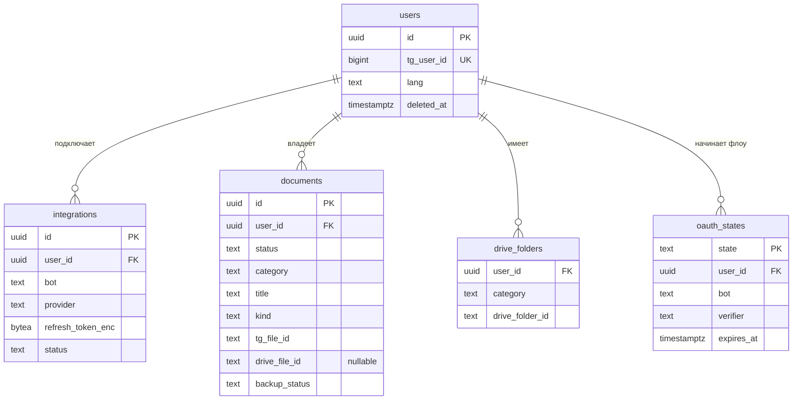

# Модель данных

В Postgres храним только метаданные (включая Telegram `file_id`). Сами файлы остаются в Telegram; при подключённом Drive копия лежит на Диске пользователя.

**Общие решения**
- ID — UUID v7 (сортируется по времени, не раскрывает число записей).
- Время — `timestamptz`, в UTC.
- Владелец таблицы: `platform` — общая для всех ботов серии, `docs` — только Most Docs.
- Не храним номера документов, ИИН, содержимое файлов и токены в открытом виде (см. [security.md](security.md)).
- Очередь фоновых задач — библиотека [River](https://riverqueue.com): свои таблицы и миграции она создаёт сама, в модели их не описываем.

## MVP

### Сводка

| Таблица         | Зачем                                                                                                                                                                                        | Ограничения и индексы                                                                                                                                              |
|-----------------|----------------------------------------------------------------------------------------------------------------------------------------------------------------------------------------------|--------------------------------------------------------------------------------------------------------------------------------------------------------------------|
| `users`         | Пользователь Most. Создаётся при первом `/start` в любом боте серии. Один Telegram-аккаунт = один пользователь. Мягкое удаление через `deleted_at`.                                          | `unique (tg_user_id)`                                                                                                                                              |
| `integrations`  | Подключение внешнего аккаунта для конкретного бота. У Most Docs и будущего Most Calendar свои токены и свои разрешения (scope).                                                              | `unique (user_id, bot, provider)`                                                                                                                                  |
| `oauth_states`  | Одноразовый `state` + PKCE verifier OAuth-флоу, привязан к `user_id` и боту. Создаётся при выдаче auth-ссылки, удаляется в callback. TTL 10 минут через `expires_at`.                        | `primary key (state)` `index (expires_at)` — чистка протухших                                                                                                   |
| `documents`     | Документ, присланный боту. Создаётся при получении, сохраняется сразу после выбора категории (в Telegram по `tg_file_id`). Drive-поля (`drive_file_id`, `backup_status`) заполняются только при выгрузке на Drive. Удаляется сразу, без мягкого удаления.                            | `unique (user_id, tg_file_unique_id)` — один файл сохраняется один раз `index (user_id, category)` — каталог `gin (title gin_trgm_ops)` — поиск с опечатками |
| `drive_folders` | Кеш папок `Most Docs/<категория>` на Drive пользователя, чтобы не искать папку через Drive API при каждой загрузке. Если папку удалили на Drive — запись удаляется и папка создаётся заново. | `primary key (user_id, category)`                                                                                                                                  |

### Статусы documents

Документ сохраняется сразу после выбора категории — это `status`:

| Статус    | Когда                                                         | Следующий |
|-----------|---------------------------------------------------------------|-----------|
| `pending` | Файл получен, ждём выбора категории                           | `saved`   |
| `saved`   | Категория выбрана, документ хранится в Telegram (`tg_file_id`) | —         |

Выгрузка на Drive — отдельный `backup_status`, задействован только при подключённом Drive:

| `backup_status` | Когда                                      | Следующий              |
|-----------------|--------------------------------------------|------------------------|
| `none`          | Drive не подключён / выгрузка не нужна       | `pending`              |
| `pending`       | Поставлен в очередь на выгрузку             | `uploading`            |
| `uploading`     | Задача выгрузки выполняется                 | `backed_up` / `failed` |
| `backed_up`     | Файл скопирован на Drive (`drive_file_id`)  | —                      |
| `failed`        | Выгрузка не удалась после ретраев           | `uploading` (повтор)   |

В каталоге и поиске 📥 показывается, пока `backup_status` ≠ `backed_up`.

> Миграция `0003_documents_backup` (в этом PR): добавляет `backup_status text not null default 'none'` с check `('none','pending','uploading','backed_up','failed')`, заменяет ограничение `status` на `('pending','saved')` и добавляет `kind text not null check ('photo','document')` — чтобы вернуть оригинал тем же методом (`sendPhoto`/`sendDocument`).

## v1

> Заглушка. Продуктовые события `events` (`user_id`, `bot`, `name`, `props`, `created_at`) для метрик активации и удержания.

## v2+

> Заглушка. Распознавание (`type`, `issued_at`, `confidence`), учёт использования (`usage`), другие хранилища.

## v3+

> Заглушка. Подписки за Stars (`subscriptions`), сроки и напоминания (`documents.expires_at`, `reminders`).

## Открытые вопросы
- `users` общая на серию, а `integrations` на каждого бота — подтвердить, что объединение аккаунтов не понадобится.
