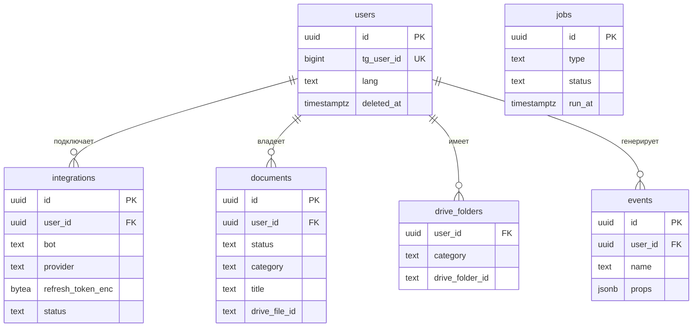
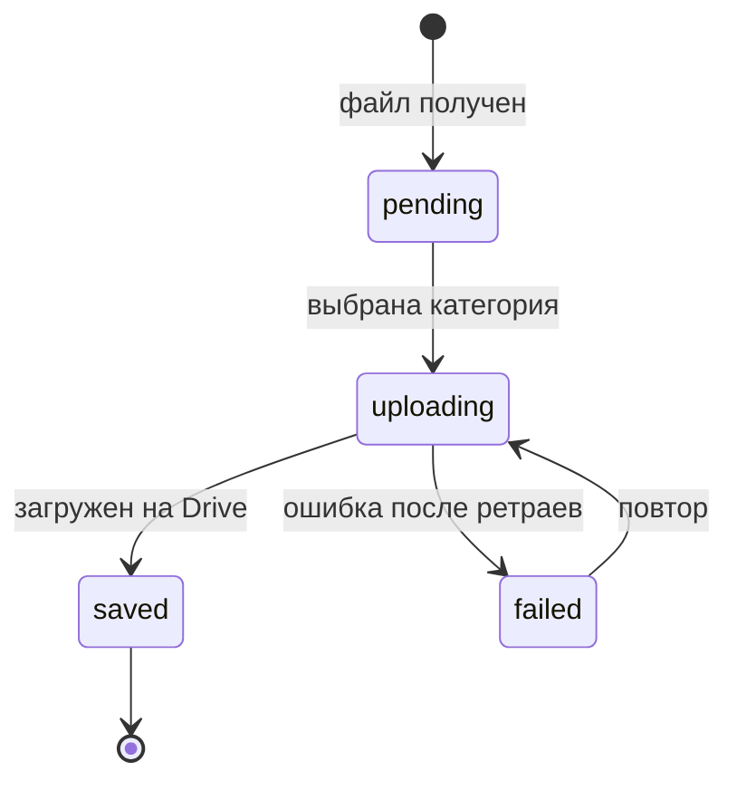

# Модель данных

В Postgres храним только метаданные; сами файлы лежат на Google Drive пользователя.

**Общие решения**
- ID — UUID v7 (сортируется по времени, не раскрывает число записей).
- Время — `timestamptz`, в UTC.
- Владелец таблицы: `platform` — общая для всех ботов серии, `docs` — только Most Docs.
- Не храним номера документов, ИИН, содержимое файлов и токены в открытом виде (см. [security.md](security.md)).

## MVP

### Сводка

| Таблица         | Зачем                                                                                                                                                                                                                                                                                                                         |
|-----------------|-------------------------------------------------------------------------------------------------------------------------------------------------------------------------------------------------------------------------------------------------------------------------------------------------------------------------------|
| `users`         | Пользователь Most. Создаётся при первом `/start` в любом боте серии. Один Telegram-аккаунт = один пользователь. Ограничения: `unique (tg_user_id)`.                                                                                                                                                                           |
| `integrations`  | Подключение внешнего аккаунта для конкретного бота. У Most Docs и будущего Most Calendar свои токены и свои разрешения (scope). Ограничения: `unique (user_id, bot, provider)`.                                                                                                                                               |
| `jobs`          | Очередь фоновых задач. Очередь фоновых задач: скачать из Telegram и загрузить на Drive, очистка удалённых юзеров. Если выберем библиотеку `river`, она создаёт свои таблицы и эта не нужна. Индексы: `index (status, run_at)` — выборка через `FOR UPDATE SKIP LOCKED`.                                                       |
| `events`        | Продуктовые события для метрик: активация, удержание, kill criterion. Индексы: `index (bot, name, created_at)`.                                                                                                                                                                                                               |
| `documents`     | Документ, который пользователь прислал боту. Запись создаётся сразу при получении файла и проходит статусы. `unique (user_id, tg_file_unique_id)` — один файл сохраняется один раз; `index (user_id, category)` — каталог; `gin (title gin_trgm_ops)` — поиск с опечатками. Документы удаляются сразу (без мягкого удаления). |
| `drive_folders` | Кеш папок `Most Docs/<категория>` на Drive пользователя. Без него при каждой загрузке пришлось бы искать папку через Drive API. Ограничения: `primary key (user_id, category)`. Если папку удалили на Drive — запись удаляется и папка создаётся заново.                                                                      |

### documents

## v1

> Заглушка. Сроки документов и напоминания: поле `documents.expires_at`, таблица `reminders`.

## v2+

> Заглушка. Распознавание (`type`, `issued_at`, `confidence`), учёт использования (`usage`), другие хранилища.

## v3+

> Заглушка. Подписки за Stars (`subscriptions`).

## Открытые вопросы
- `users` общая на серию, а `integrations` на каждого бота — подтвердить, что объединение аккаунтов не понадобится.
- `jobs`: своя таблица или `river`.