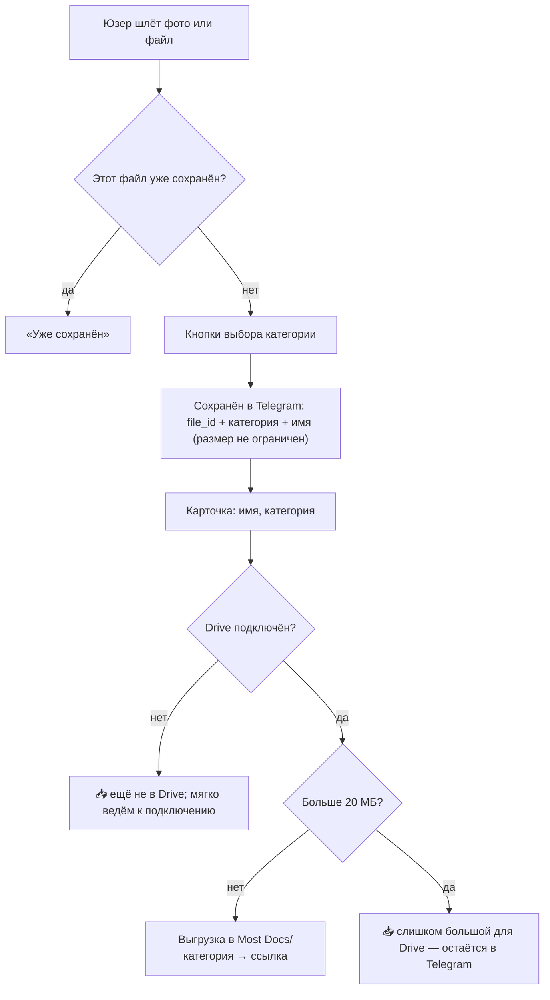

# Most Docs — продукт

Most Docs — Telegram-бот: пересылаешь любой документ (фото, PDF, файл), он раскладывает его по категориям и находит по запросу. Цель — чтобы документы лежали на **твоём** Google Drive. Пока Drive не подключён, они хранятся в Telegram, во «входящей папке»; начать можно без настройки, а Drive подключается в пару тапов, когда удобно. Первый бот серии Most на общем ядре.

**Проблема.** Документы разбросаны по галерее, чатам и почте, и в нужный момент их не найти.

**Ценность MVP.** Ценность сразу, без настройки: переслал боту → выбрал категорию → документ сохранён и ищется по запросу «паспорт». Для старта не нужен Google Drive — документы ждут во входящей папке в Telegram. Подключишь Drive — они переедут на твой Диск, туда же будут попадать новые.

**Цель.** В MVP проверить спрос (органические пользователи), монетизация с v3.

**Не-цели MVP.** Своё хранилище файлов, WhatsApp, мобильное приложение, веб-кабинет, команды и бизнес.

## Возможности Telegram

| Возможность                   | Что даёт                                                            |
|-------------------------------|---------------------------------------------------------------------|
| Чат, команды, inline-кнопки   | Основной интерфейс: `/start`, `/list`, выбор категории, пагинация   |
| Приём и отправка файлов       | Храним `file_id` любого размера; бот скачивает и отправляет до 20 МБ через облачный Bot API (до 2 ГБ со своим Bot API сервером) |
| Inline-режим (`@bot паспорт`) | Поиск и отправка документа из любого чата                           |
| Mini App                      | Веб-интерфейс внутри Telegram                                       |
| Telegram Stars                | Оплата и подписки внутри Telegram, без эквайринга                   |
| Реферальная программа         | Партнёры продвигают бота за долю с оплат Stars                      |

Ограничения: ~30 сообщений/с на бота (важно для массовых рассылок); цифровые товары — только за Stars. Перепроверить по документации Bot API.

## Функции по версиям

| Функция              | Что делает                                                               | Версия  |
|----------------------|--------------------------------------------------------------------------|---------|
| Онбординг               | `/start` → «Пришлите документ», можно начать без настройки Drive          | MVP     |
| Приём документа         | Фото, PDF, файл; пересланные из других чатов тоже                        | MVP     |
| Категория               | Кнопки выбора категории (список ниже)                                    | MVP     |
| Входящая папка (Telegram) | Пока Drive не подключён, документ хранится в Telegram: `file_id` + категория + имя | MVP |
| Подключение Google Drive | Папки `Most Docs/<категория>` на твоём Диске; при подключении — перенос сохранённых, новые автоматически. Область `drive.file` не видит папки, созданные вручную, поэтому бот всегда создаёт свою `Most Docs` (если такая уже есть у тебя — их станет две; это ожидаемо). При каждом (пере)подключении кеш id папок сбрасывается | MVP |
| Каталог                 | `/list`: документы по категориям, «Прислать файл»; 📥 у тех, что ещё не в Drive | MVP |
| Поиск                   | Текст в чат → совпадения по имени и категории                            | MVP     |
| Удаление данных         | `/settings`: отключить Drive, «Удалить мои данные»                       | MVP     |
| Inline-режим         | Отправить документ из любого чата                                        | v1      |
| Распознавание        | LLM vision: тип, название, даты → автоимя, автокатегория                 | v2      |
| Своё хранилище       | Яндекс Диск, Dropbox, WebDAV/S3 вместо Google Drive                      | v2      |
| Mini App             | Каталог с фильтрами и превью                                             | v2      |
| Поиск по содержимому | OCR-текст документа в поиске                                             | v2      |
| Подписка             | Лимит бесплатного тарифа → Stars                                         | v3      |
| Сроки и напоминания  | Срок действия документа, напоминание до окончания                        | v3+     |
| Рефералы             | Партнёрская программа Stars                                              | v4      |

**Категории (MVP):** Паспорт и ID · Справки · Страховки · Недвижимость · Чеки и гарантии · Авто · Медицина · Путешествия · Учёба · Работа · Другое. Подпись и имя папки на Drive — одна и та же; старый или неизвестный slug показывается как «Другое». 

Список — гипотеза, уточняем по первым пользователям.

## Сценарии

**Загрузка документа (MVP)**

Лимита на приём нет: храним `file_id`. 20 МБ — предел скачивания ботом (облачный Bot API), поэтому он касается только выгрузки в Drive. В v2 категорию и имя определяет LLM, кнопки остаются для исправления.

**Другие сценарии**

1. **Онбординг (MVP).** `/start` → «Пришлите первый документ» (Drive можно подключить позже). После 1-го и 5-го сохранения — мягкое предложение подключить Google Drive, чтобы документы переехали на твой Диск.
2. **Поиск (MVP).** Юзер пишет «страховка» → совпадения с кнопкой «Прислать» и, если документ уже в Drive, «Открыть в Drive».

## Риски

| Риск                                         | Влияние                                                             | Что делаем                                                                 |
|----------------------------------------------|---------------------------------------------------------------------|----------------------------------------------------------------------------|
| «Мои паспорта в Telegram» — не доверяют      | Низкая активация                                                    | Цель — файлы на их Google Drive; до подключения — входящая папка в Telegram под их аккаунтом; понятная политика; старт с чеков и гарантий |
| ИИ-ассистенты и приложение Drive умеют то же | Нет причины пользоваться                                            | Скорость: всё в Telegram, сохранить и найти в пару тапов; местные документы KZ |
| Верификация Google затянется                 | До неё — до 100 тестовых юзеров и плашка «непроверенное приложение» | Запуск не блокирует: до подключения Drive документы уже работают в Telegram, плашка не на пути первого документа; подать на верификацию сразу после запуска ядра |
| Нет Google-аккаунта или юзер на Яндекс Диске | Отток на шаге подключения Drive                                     | До подключения документы уже работают в Telegram; вести к Drive мягко; своё хранилище в v2 |
| Утечка токена бота                            | Чужой доступ ко всем файлам в Telegram через Bot API                | Токен только в env, не в логах и коде; при утечке — Revoke в BotFather (старые `file_id` продолжают работать у бота) |
| Бот удалён или потерян аккаунт владельца бота | Потеря доступа к файлам в Telegram (`file_id` перестают работать)   | Поэтому ведём к подключению Drive — надёжная копия на Диске юзера           |
| Ошибки распознавания (v2)                    | Неверные имя и категория                                            | `confidence` + подтверждение пользователем                                 |