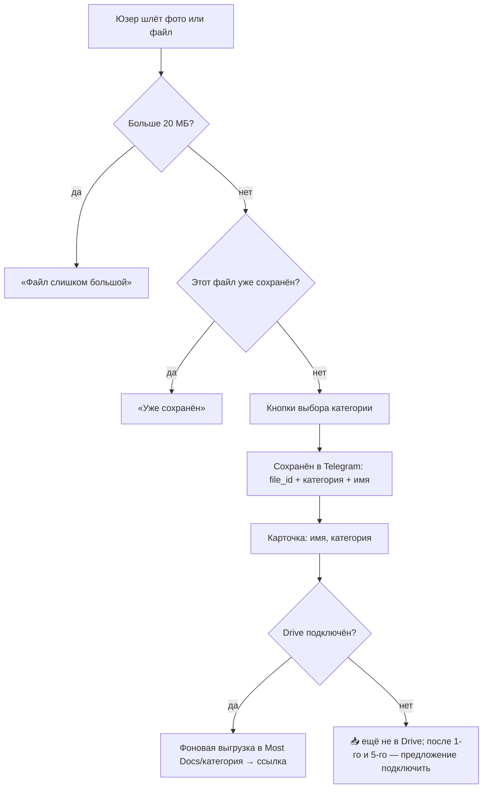

# Most Docs — продукт

Most Docs — Telegram-бот: пересылаешь любой документ (фото, PDF, файл), он раскладывает его по категориям и находит по запросу. Документы хранятся прямо в Telegram; Google Drive подключается по желанию как надёжная копия на **твоём** Диске. Первый бот серии Most на общем ядре.

**Проблема.** Документы разбросаны по галерее, чатам и почте, и в нужный момент их не найти.

**Ценность MVP.** Ценность сразу, без настройки: переслал боту → выбрал категорию → документ сохранён и ищется по запросу «паспорт». Google Drive не нужен для старта — подключается позже как надёжная копия на своём Диске.

**Цель.** В MVP проверить спрос (органические пользователи), монетизация с v3.

**Не-цели MVP.** Своё хранилище файлов, WhatsApp, мобильное приложение, веб-кабинет, команды и бизнес.

## Возможности Telegram

| Возможность                   | Что даёт                                                            |
|-------------------------------|---------------------------------------------------------------------|
| Чат, команды, inline-кнопки   | Основной интерфейс: `/start`, `/list`, выбор категории, пагинация   |
| Приём и отправка файлов       | До 20 МБ через облачный Bot API (до 2 ГБ со своим Bot API сервером) |
| Inline-режим (`@bot паспорт`) | Поиск и отправка документа из любого чата                           |
| Mini App                      | Веб-интерфейс внутри Telegram                                       |
| Telegram Stars                | Оплата и подписки внутри Telegram, без эквайринга                   |
| Реферальная программа         | Партнёры продвигают бота за долю с оплат Stars                      |

Ограничения: ~30 сообщений/с на бота (важно для массовых рассылок); цифровые товары — только за Stars. Перепроверить по документации Bot API.

## Функции по версиям

| Функция              | Что делает                                                               | Версия  |
|----------------------|--------------------------------------------------------------------------|---------|
| Онбординг            | `/start` → «Пришлите документ»; Drive не обязателен                       | MVP     |
| Приём документа      | Фото, PDF, файл; пересланные из других чатов тоже                        | MVP     |
| Категория            | Кнопки выбора категории (список ниже)                                    | MVP     |
| Хранение в Telegram  | После категории документ сохранён сразу: в БД `file_id` + категория + имя | MVP     |
| Бэкап в Google Drive | Опционально: подключил Drive → перенос сохранённых + новые автоматически в `Most Docs/<категория>` | MVP |
| Каталог              | `/list`: документы по категориям, «Прислать файл»; 📥 у тех, что ещё не в Drive | MVP |
| Поиск                | Текст в чат → совпадения по имени и категории                            | MVP     |
| Удаление данных      | `/settings`: вкл/выкл бэкап в Drive, «Удалить мои данные»                 | MVP     |
| Inline-режим         | Отправить документ из любого чата                                        | v1      |
| Распознавание        | LLM vision: тип, название, даты → автоимя, автокатегория                 | v2      |
| Своё хранилище       | Яндекс Диск, Dropbox, WebDAV/S3 вместо Google Drive                      | v2      |
| Mini App             | Каталог с фильтрами и превью                                             | v2      |
| Поиск по содержимому | OCR-текст документа в поиске                                             | v2      |
| Подписка             | Лимит бесплатного тарифа → Stars                                         | v3      |
| Сроки и напоминания  | Срок действия документа, напоминание до окончания                        | v3+     |
| Рефералы             | Партнёрская программа Stars                                              | v4      |

**Категории (MVP):** Паспорт и ID · Договоры · Чеки и гарантии · Авто · Медицина · Учёба и работа · Другое. 

Список — гипотеза, уточняем по первым пользователям.

## Сценарии

**Загрузка документа (MVP)**

В v2 категорию и имя определяет LLM, кнопки остаются для исправления.

**Другие сценарии**

1. **Онбординг (MVP).** `/start` → «Пришлите первый документ» (Drive не нужен). После 1-го и 5-го сохранения — мягкое предложение подключить Google Drive как копию.
2. **Поиск (MVP).** Юзер пишет «страховка» → совпадения с кнопкой «Прислать» и, если документ уже в Drive, «Открыть в Drive».

## Риски

| Риск                                         | Влияние                                                             | Что делаем                                                                 |
|----------------------------------------------|---------------------------------------------------------------------|----------------------------------------------------------------------------|
| «Мои паспорта в Telegram» — не доверяют      | Низкая активация                                                    | По умолчанию файлы в Telegram под их аккаунтом; Drive на их Диске — по желанию; понятная политика; старт с чеков и гарантий |
| ИИ-ассистенты и приложение Drive умеют то же | Нет причины пользоваться                                            | Скорость: всё в Telegram, сохранить и найти в пару тапов; местные документы KZ |
| Верификация Google затянется                 | До неё — до 100 тестовых юзеров и плашка «непроверенное приложение» | Запуск не блокирует: Drive опционален, плашка не на пути первого документа; подать на верификацию сразу после запуска ядра |
| Нет Google-аккаунта или юзер на Яндекс Диске | Раньше — отток на онбординге                                        | Drive не обязателен: документы работают и без него; предлагать мягко; своё хранилище в v2 |
| Потеря токена бота или удаление бота          | Доступ к файлам в Telegram теряется                                 | Токен — только в env, Revoke при утечке; подключённый Drive — надёжная копия |
| Ошибки распознавания (v2)                    | Неверные имя и категория                                            | `confidence` + подтверждение пользователем                                 |