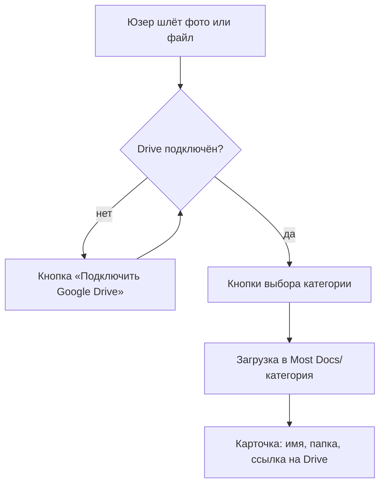

# Most Docs — дизайн-док

> Набросок, не финал

Связанные файлы: [architecture.md](architecture.md) · [model.md](model.md) · [security.md](security.md) · [stack.md](stack.md) · [monetization.md](monetization.md)

## Обзор

Most Docs — Telegram-бот: пересылаешь любой документ (фото, PDF, файл), он сохраняет его в нужную папку на Google Drive и находит по запросу. Первый бот серии Most на общем ядре.

**Проблема и пользователь.** Документы разбросаны по галерее, чатам и почте, а об истёкшем сроке узнаёшь поздно. Пользователь — обычный человек в KZ/RU/CIS с Google Drive.

**Цель.** В MVP проверить спрос (органические пользователи), монетизация с v3.

**Не-цели MVP.** Своё хранилище файлов, WhatsApp, мобильное приложение, веб-кабинет, команды и бизнес.

**Метрики**

| Метрика | Что считаем | Цель на старте |
| --- | --- | --- |
| Активация | Доля `/start`, загрузивших первый документ | 40% |
| Удержание | Загрузил документ на 7-й день и позже | 20% |
| Конверсия (с v3) | Доля активных, купивших подписку | 2–3% |
| Kill criterion | Органические `/start` за месяц после запуска | меньше 30 → закрываем |

## Возможности Telegram

| Возможность | Что даёт | Версия |
| --- | --- | --- |
| Чат, команды, inline-кнопки | Основной интерфейс: `/start`, `/list`, выбор категории, пагинация | MVP |
| Приём и отправка файлов | До 20 МБ через облачный Bot API (до 2 ГБ со своим Bot API сервером) | MVP |
| Inline-режим (`@bot паспорт`) | Поиск и отправка документа из любого чата | v1 |
| Mini App | Веб-интерфейс каталога: фильтры, превью, редактирование | v2 |
| Telegram Stars | Подписки внутри Telegram, без эквайринга | v3 |
| Реферальная программа | Партнёры продвигают бота за долю с оплат Stars | v4 |

Ограничения: ~30 сообщений/с на бота (важно для массовых напоминаний); цифровые товары — только за Stars. Перепроверить по документации Bot API.

## Функции по версиям

| Функция | Что делает | Версия |
| --- | --- | --- |
| Онбординг | `/start` → «Подключить Google Drive» (OAuth, `drive.file`) | MVP |
| Приём документа | Фото, PDF, файл; пересланные из других чатов тоже | MVP |
| Категория | Кнопки выбора категории (паспорт, договор, чек…) | MVP |
| Сохранение на Drive | Папка `Most Docs/<категория>`, имя из подписи или `Категория — дата.ext` | MVP |
| Каталог | `/list`: документы по категориям, ссылка на Drive, «Прислать файл» | MVP |
| Поиск | Текст в чат → совпадения по имени и категории | MVP |
| Удаление данных | `/settings`: отключить Drive, «Удалить мои данные» | MVP |
| Inline-режим | Отправить документ из любого чата | v1 |
| Сроки и напоминания | Срок вводится вручную, напоминание за 30 и 7 дней | v1 |
| Распознавание | LLM vision: тип, название, даты → автоимя, автокатегория, автосрок | v2 |
| Своё хранилище | Яндекс Диск, Dropbox, WebDAV/S3 вместо Google Drive | v2 |
| Mini App | Каталог с фильтрами и превью | v2 |
| Поиск по содержимому | OCR-текст документа в поиске | v2 |
| Подписка | Лимит бесплатного тарифа → Stars | v3 |
| Рефералы | Партнёрская программа Stars | v4 |

## Roadmap

```mermaid
flowchart LR
    MVP["<b>MVP</b><br/>Drive, приём файлов,<br/>категории, каталог, поиск"]
    V1["<b>v1</b><br/>inline-режим,<br/>сроки и напоминания"]
    V2["<b>v2</b><br/>распознавание (LLM),<br/>своё хранилище, Mini App"]
    V3["<b>v3</b><br/>подписка за Stars"]
    V4["<b>v4</b><br/>реферальная программа"]
    S["<b>Серия Most</b><br/>бот календаря и др.<br/>на том же ядре"]

    MVP -->|"≥30 /start в месяц"| V1
    V1 -->|"удержание ≥20%"| V2
    V2 -->|"стабильная база активных"| V3
    V3 -->|"есть оплаты"| V4
    V4 -.-> S
```

Следующий этап начинаем, только когда выполнено условие перехода; иначе итерируем внутри текущего. Сроки после MVP не фиксируем.

## Сценарии

**Загрузка документа (MVP)**

В v2 категорию и имя определяет LLM, кнопки остаются для исправления.

**Другие сценарии**

1. **Онбординг (MVP).** `/start` → «Подключить Google Drive» → OAuth в браузере → возврат в чат → «Пришлите первый документ».
2. **Поиск (MVP).** Юзер пишет «страховка» → совпадения с кнопками «Прислать» и «Открыть в Drive».
3. **Напоминание (v1).** За 30 дней: «Страховка истекает 1 декабря» + «Напомнить позже» / «Уже продлил».
4. **Оплата (v3).** Превышен лимит → инвойс в Stars → `successful_payment` → подписка активна.

## Риски

| Риск | Влияние | Что делаем |
| --- | --- | --- |
| Люди не доверяют боту паспорт | Низкая активация | Файлы только на их Drive, понятная политика, старт с чеков и гарантий |
| ИИ-ассистенты умеют то же | Нет причины пользоваться | Скорость в Telegram, напоминания, местные документы KZ |
| Верификация Google затянется | До неё — до 100 тестовых юзеров и плашка «непроверенное приложение» | Подать на верификацию сразу после запуска ядра |
| Нет Google-аккаунта или юзер на Яндекс Диске | Отток на онбординге | Мерить отвал на шаге OAuth; своё хранилище в v2 |
| Ошибки распознавания дат (v2) | Неверные напоминания | `confidence` + подтверждение пользователем |
